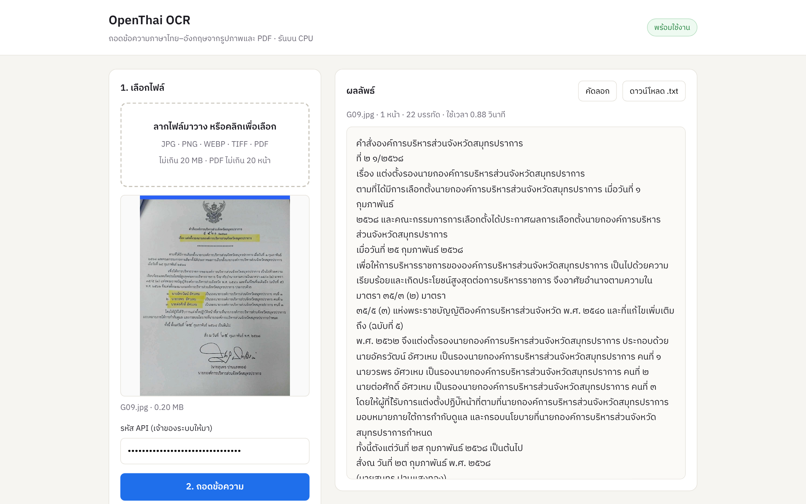
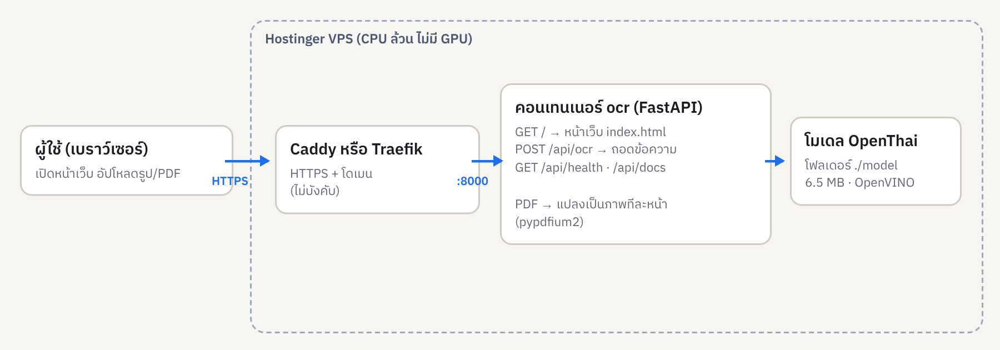

# OpenThai OCR — ถอดข้อความภาษาไทยจากรูปและ PDF บน CPU

API + หน้าเว็บอัปโหลดเอกสาร สำหรับโมเดล [OpenThai2.1-OCR-Text](https://huggingface.co/iapp/OpenThai2.1-OCR-Text-20261118) ของ iApp Technology
รันด้วย Docker บน VPS ทั่วไป (ทดสอบบน Hostinger KVM 2) **ไม่ต้องมี GPU**



- ลากรูป (JPG, PNG, WEBP, TIFF) หรือ PDF มาวาง ได้ข้อความกลับมาในราว 1 วินาทีต่อหน้า
- มี API `POST /api/ocr` ให้ n8n หรือโปรแกรมอื่นเรียก และหน้าเอกสาร API ที่ `/api/docs`
- ป้องกันด้วยรหัส API, จำกัดขนาดไฟล์และจำนวนหน้า PDF ได้
- ใช้ RAM ราว 300–500 MB ต่อ worker โมเดลรวม 6.5 MB

## ติดตั้ง

ต้องมี: Ubuntu 22.04/24.04 ที่ลง Docker + Docker Compose v2.24 ขึ้นไปแล้ว (เช็กด้วย `docker compose version`)

```bash
git clone https://github.com/Jaruphat/openthai-ocr.git /opt/openthai-ocr
cd /opt/openthai-ocr
./download-model.sh
cp .env.example .env && sed -i "s/^API_KEY=.*/API_KEY=$(openssl rand -hex 16)/" .env
docker compose up -d --build
```

ครั้งแรกใช้เวลา build ราว 1 นาที จากนั้นเปิด `http://IP-ของ-VPS:8000`
รหัส API สำหรับใส่ในหน้าเว็บดูได้ด้วย `grep API_KEY .env`

ยังไม่มี Docker: `curl -fsSL https://get.docker.com | sh`

## ทดสอบด้วย curl

```bash
curl -s localhost:8000/api/health
curl -s -X POST localhost:8000/api/ocr \
  -H "X-API-Key: $(grep ^API_KEY= .env | cut -d= -f2)" \
  -F file=@receipt.jpg
```

ผลลัพธ์เป็น JSON:

```json
{
  "model": "OpenThai2.1-OCR-Text v2.1.4",
  "file": "receipt.jpg",
  "pages": [{ "page": 1, "text": "ใบเสร็จรับเงิน\n...", "lines": 27, "rotation": 0 }],
  "text": "ใบเสร็จรับเงิน\n...",
  "seconds": 0.59
}
```

## ใส่โดเมน + HTTPS

ใส่ชื่อโดเมนใน `.env` (เช่น `DOMAIN=ocr.example.com`) ให้ DNS ชี้มาที่ IP ของ VPS
ยังไม่มีโดเมน ใช้ชื่อฟรีของ [sslip.io](https://sslip.io) ได้ เช่น IP `203.0.113.10` → `DOMAIN=ocr.203-0-113-10.sslip.io`

**ทาง A — เครื่องว่าง (พอร์ต 80/443 ไม่มีใครใช้):** Caddy ขอใบรับรอง HTTPS ให้อัตโนมัติ

```bash
docker compose --profile https up -d
```

**ทาง B — เครื่องมี Traefik อยู่แล้ว** (เช่น ติดตั้งแอปผ่าน Docker Manager ของ Hostinger):

```bash
docker compose -f docker-compose.yml -f docker-compose.traefik.yml up -d
```

เช็กว่าพอร์ตว่างไหม: `ss -ltnp | grep -E ':(80|443) '`
เมื่อใช้ HTTPS แล้ว ควรปิดพอร์ต 8000 (ใส่ `#` หน้า `ports:` ของ service `ocr` ใน `docker-compose.yml`)

## ตั้งค่า (`.env`)

| ตัวแปร | ค่าเริ่มต้น | ความหมาย |
| --- | --- | --- |
| `API_KEY` | ว่าง | รหัสสำหรับเรียกใช้ ว่าง = ไม่ต้องใส่รหัส (ไม่แนะนำบนเครื่องที่เปิดสาธารณะ) |
| `WORKERS` | 1 | จำนวนงานที่อ่านพร้อมกัน แนะนำ = จำนวน vCPU |
| `OCR_THREADS` | 1 | thread ต่อ worker |
| `MAX_UPLOAD_MB` | 20 | ขนาดไฟล์สูงสุด |
| `MAX_PDF_PAGES` | 20 | จำนวนหน้า PDF สูงสุด |
| `PDF_DPI` | 200 | ความละเอียดตอนแปลง PDF เป็นภาพ |
| `DOMAIN` | ว่าง | โดเมนสำหรับ HTTPS (Caddy/Traefik) |

แก้ `.env` แล้วสั่ง `docker compose up -d`

## เรียกจาก n8n

โหนด **HTTP Request**: Method `POST` · URL `https://โดเมน/api/ocr` · Authentication: Header Auth ชื่อ `X-API-Key` ·
Body: Form-Data → `n8n Binary File` ชื่อ `file` (Input Data Field `data`) · ข้อความอยู่ที่ `{{ $json.text }}`

## อัปเดต

```bash
cd /opt/openthai-ocr
git pull
docker compose up -d --build
```

เปลี่ยนเวอร์ชันโมเดล: `REV=v2.x.x ./download-model.sh && docker compose restart ocr`

## โครงสร้าง



| ไฟล์ | หน้าที่ |
| --- | --- |
| `app.py` | FastAPI: หน้าเว็บ `/`, `/api/health`, `/api/ocr` (แปลง PDF เป็นภาพด้วย pypdfium2) |
| `static/index.html` | หน้าเว็บอัปโหลด ไฟล์เดียว |
| `download-model.sh` | ดาวน์โหลดโมเดลจาก Hugging Face (ตรึงเวอร์ชัน v2.1.4) และตรวจ SHA256 |
| `Dockerfile`, `requirements.txt` | สร้าง image (python:3.12-slim + OpenVINO) |
| `docker-compose.yml` | service `ocr` + `caddy` (profile `https`) |
| `docker-compose.traefik.yml` | ใช้กับ Traefik ที่มีอยู่แล้ว |
| `Caddyfile` | ตั้งค่า reverse proxy + HTTPS |

## ข้อจำกัด

- โมเดลอ่านตัวพิมพ์ไทย–อังกฤษได้ดี ลายมือและตัวอักษรในภาพถ่ายทั่วไปยังอ่อน
- ให้ผลเป็นข้อความล้วน ไม่สร้างตาราง/Markdown
- 1 worker อ่านทีละหน้า ถ้ามีคนใช้พร้อมกันหลายคนให้เพิ่ม `WORKERS`

## สัญญาอนุญาต

โค้ดใน repo นี้: MIT License
โมเดล OpenThai2.1-OCR-Text: Apache-2.0 โดย iApp Technology (ดาวน์โหลดจาก Hugging Face ตอนติดตั้ง ไม่ได้แจกจ่ายใน repo นี้)
